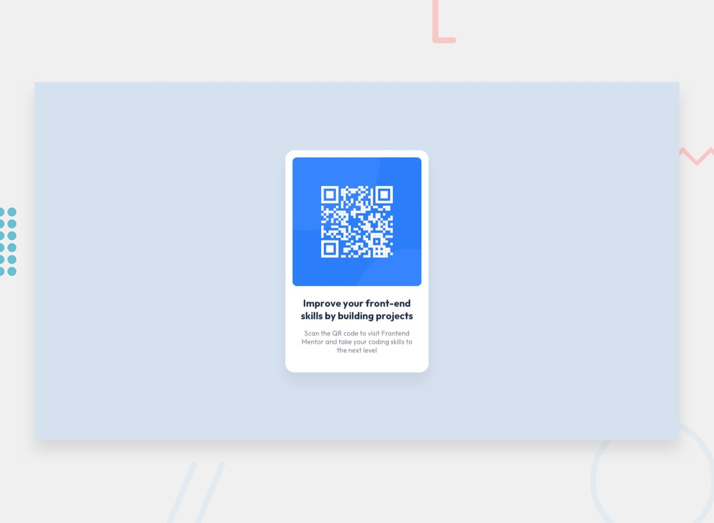

# Frontend Mentor - Componente de código QR

## Boas-vindas! 👋

Obrigado por conferir este desafio de desenvolvimento front-end.

Os desafios do [Frontend Mentor](https://www.frontendmentor.io) ajudam você a aprimorar suas habilidades de programação criando projetos realistas.

**Para realizar este desafio, você precisa ter conhecimentos básicos de HTML e CSS.**

## O desafio

Seu desafio é desenvolver este componente de código QR e deixá-lo o mais parecido possível com o design.

Você pode usar as ferramentas que preferir para concluir o desafio. Se quiser praticar algo específico, fique à vontade para experimentar.

### Quer ajuda com o desafio?

[Participe da nossa comunidade](https://www.frontendmentor.io/community) e faça perguntas no canal **#help**.

## Onde encontrar os arquivos

Sua tarefa é desenvolver o projeto com base nos designs da pasta `/design`. Você encontrará versões para dispositivos móveis e computadores.

Os designs estão em formato JPG estático. Por isso, você precisará usar seu próprio julgamento para definir estilos como `font-size`, `padding` e `margin`.

Se quiser acessar o arquivo de design do Figma para ganhar experiência com ferramentas profissionais e criar projetos mais precisos com mais rapidez, você pode [assinar o plano PRO](https://www.frontendmentor.io/pro).

Você encontrará todos os recursos necessários na pasta `/images`. Eles já estão otimizados.

Também há um arquivo `style-guide.md` com informações úteis, como a paleta de cores e as fontes.

## Como usar assistentes de programação com IA

Incluímos dois arquivos para ajudar caso você use assistentes de programação com IA (como Claude, GitHub Copilot, Cursor etc.) durante este desafio:

- `AGENTS.md` - Contém instruções detalhadas para que assistentes de IA ajudem você neste desafio. O conteúdo é adaptado ao nível de dificuldade, para que a IA ofereça orientações adequadas à sua etapa de aprendizado: mais apoio nos desafios para iniciantes e mais autonomia nos desafios avançados.
- `CLAUDE.md` - Um arquivo de referência que direciona ferramentas baseadas no Claude às instruções de `AGENTS.md`.

**Como usá-los:** Você não precisa fazer nada! A maioria das ferramentas de programação com IA detecta esses arquivos automaticamente. A IA vai lê-los e ajustar seu comportamento para ser uma parceira de aprendizado melhor, orientando você na busca por soluções em vez de simplesmente entregar as respostas.

**Observação:** Esses arquivos foram criados para ajudar você a *aprender*, não para fazer o trabalho por você. As instruções orientam a IA a fazer perguntas, dar dicas e explicar conceitos, em vez de escrever soluções completas.

## Como desenvolver seu projeto

Use o fluxo de trabalho com o qual se sentir mais à vontade. Abaixo está uma sugestão de processo, mas você não precisa seguir estas etapas à risca:

1. Inicialize seu projeto como um repositório público no [GitHub](https://github.com/). Criar um repositório facilita o compartilhamento do seu código com a comunidade caso precise de ajuda. Se não souber como fazer isso, [consulte este material sobre Git](https://try.github.io/).
2. Configure o repositório para publicar seu código em um endereço da web. Isso também será útil caso precise de ajuda durante o desafio: você poderá compartilhar o URL do projeto junto com o URL do repositório. Há várias maneiras de fazer isso; recomendamos algumas mais abaixo.
3. Examine os designs e comece a planejar como desenvolver o projeto. Esta etapa é essencial para antecipar as classes CSS necessárias à criação de estilos reutilizáveis.
4. Antes de adicionar estilos, estruture o conteúdo com HTML. Escrever o HTML primeiro ajuda a manter o foco em criar um conteúdo bem organizado.
5. Defina os estilos básicos do projeto, incluindo estilos gerais para o conteúdo, como `font-family` e `font-size`.
6. Comece a adicionar estilos do topo da página para baixo. Só passe para a próxima seção quando estiver satisfeito com a área em que está trabalhando.

## Como publicar seu projeto

Como mencionado acima, há muitas maneiras de hospedar seu projeto gratuitamente. Recomendamos estas plataformas:

- [GitHub Pages](https://pages.github.com/)
- [Vercel](https://vercel.com/)
- [Netlify](https://www.netlify.com/)

Você pode hospedar seu site usando uma dessas opções ou qualquer outro provedor de confiança. [Saiba mais sobre as plataformas de hospedagem que recomendamos](https://www.frontendmentor.io/guides/hosting-your-solution).

## Crie um `README.md` personalizado

Recomendamos que você substitua este `README.md` por um arquivo personalizado. Incluímos um modelo no arquivo [`README-template.md`](./README-template.md), neste código inicial.

O modelo orienta você sobre o que incluir. Um `README` personalizado ajudará a explicar seu projeto e refletir sobre o que aprendeu. Fique à vontade para editar o modelo como preferir.

Depois de adicionar suas informações ao modelo, exclua este arquivo e renomeie `README-template.md` para `README.md`. Assim, ele será exibido como o README do seu repositório.

## Como enviar sua solução

Envie sua solução pela plataforma para que o restante da comunidade possa vê-la. Consulte nosso ["Guia completo para enviar soluções"](https://www.frontendmentor.io/guides/how-to-submit-solutions) para saber como fazer isso.

Se quiser receber comentários sobre sua solução, lembre-se de fazer perguntas ao enviá-la. Quanto mais específicas e detalhadas forem suas perguntas, maior será a chance de receber comentários úteis da comunidade.

## Como compartilhar sua solução

Há vários lugares onde você pode compartilhar sua solução:

1. Compartilhe a página da sua solução no canal **#finished-projects** da [comunidade](https://www.frontendmentor.io/community).
2. Compartilhe no [X (antigo Twitter)](https://x.com/frontendmentor) e mencione **@frontendmentor**. Inclua na publicação os URLs do repositório e do projeto publicado. Adoraríamos ver o que você criou e ajudar a divulgar seu trabalho.
3. Compartilhe sua solução no [LinkedIn](https://www.linkedin.com/company/frontend-mentor/).
4. Escreva em um blog sobre sua experiência desenvolvendo o projeto. Falar sobre seu fluxo de trabalho, suas escolhas técnicas e seu código é uma ótima maneira de reforçar o que aprendeu. Boas plataformas para escrever são [dev.to](https://dev.to/), [Hashnode](https://hashnode.com/) e [CodeNewbie](https://community.codenewbie.org/).

Oferecemos modelos para ajudar você a compartilhar sua solução depois de enviá-la pela plataforma. Edite-os à vontade e inclua perguntas específicas se estiver buscando comentários.

Quanto mais específicas forem suas perguntas, maior será a chance de alguém da comunidade enviar comentários.

## Tem algum comentário para nós?

Adoramos receber comentários! Estamos sempre buscando melhorar nossos desafios e nossa plataforma. Se quiser compartilhar algo conosco, envie um e-mail para hi[at]frontendmentor[dot]io.

Este desafio é totalmente gratuito. Compartilhe-o com quem possa aproveitá-lo para praticar.

**Divirta-se desenvolvendo!** 🚀
